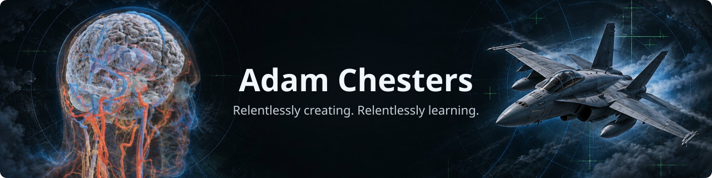

  
  
  
  
  

Hi, I'm Adam. Two-time founder with an exit, based in Melbourne.

I started my first company in a garage at 23 and built a live-streaming platform in 2009. Then I spent a decade delivering at the F1, Ultra Music Festival, the Australian Open, Fortress Melbourne and the Future Fund.

Now I'm building [WroteItMyself](https://wroteitmyself.com), something that brings the human back to a world drowning in generic output. Everything else here, I make for fun.

### 🧠 Experiments

- **[adambrain](https://github.com/AdamChesters/adambrain)**: an interactive portrait made from my own MRI scan, rendered as volumes in your browser.

### ✈️ Flight sim and VR

- **[psvr2passthrough](https://github.com/AdamChesters/psvr2passthrough)**: mixed reality on PC. The PSVR2 passthrough cameras as an OpenXR layer.
- **[dcs2psvr2-shaker](https://github.com/AdamChesters/dcs2psvr2-shaker)**: DCS World haptics for the PSVR2 headset on PC. Six aircraft families, from the F/A-18C Hornet to the AH-64D Apache. Alpha.
- **[dcs2streamdeck](https://github.com/AdamChesters/dcs2streamdeck)**: Stream Deck plugin and desktop app with live DCS World cockpit state for the F/A-18C Hornet and F-16C Viper. Alpha.
- **[ReadyForLaunch](https://github.com/AdamChesters/ReadyForLaunch)**: a compact Windows app launcher and manager, made for flight sims. Alpha.
- **[7700-Aircraft-Alert](https://github.com/AdamChesters/7700-Aircraft-Alert)**: watches for aircraft squawking an emergency code.

### 🛠️ Desktop and streaming

- **[frothedboard](https://github.com/AdamChesters/frothedboard)**: why one clipboard when many clipboard do better.
- **[FrodoTappins: There and Backspace Again](https://github.com/AdamChesters/FrodoTappins-There-And-Backspace-Again)**: a private, portable counter for keystrokes, words and alt-tabs on Windows.
- **[obs-the-circle](https://github.com/AdamChesters/obs-the-circle)**: a shrinking circle-on-a-map overlay for OBS.

---

<h3 align="center">Support</h3>

I love making things to have fun, share fun, and make life a lil better. If you got value out of one of them, feel free to buy us a coffee. Or a house. Push comes to shove, I prefer Aston Martin. Supporters get golden crowns on the Discord / tags on the subreddit!

  
  
  

